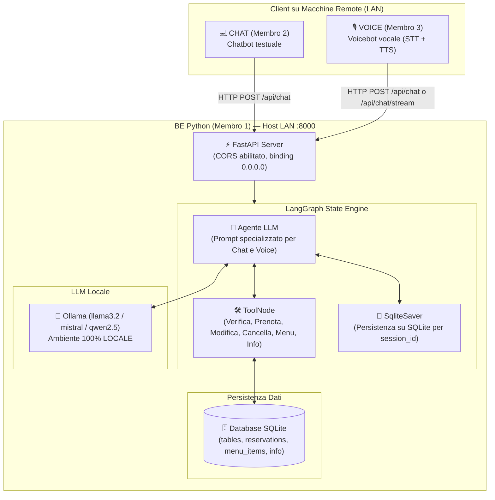

# AI 4 Restaurants — Sistema di Prenotazione Ristorante con AI

Sistema distribuito di intelligenza artificiale per la prenotazione di tavoli in un noto ristorante (**Trattoria Bella Napoli**), sviluppato in team di 3 persone:

| Componente | Membro | Descrizione |
|---|---|---|
| **BE** | **Membro 1** | Backend Python con LLM locale (LangGraph, LangChain) e database SQLite (gestione disponibilità, tavoli, menu, prenotazioni) |
| **CHAT** | **Membro 2** | Chatbot testuale che chiama il BE via rete locale (Streamlit / UI di chat) |
| **VOICE** | **Membro 3** | Voicebot vocale che chiama il BE via rete locale (STT Whisper locale + TTS) |



---

## 📐 Vincoli di Progetto Rispettati

1. **Tre macchine separate (LAN)**: Il BE ascolta su `0.0.0.0:8000` con CORS aperto a tutte le origini LAN.
2. **Comunicazione via rete**: API REST e Streaming SSE su HTTP JSON documentate via Swagger su `/docs`.
3. **Privacy / PII (vincolo rivisto dal gruppo)**: nome e telefono servono al ristorante per contattare il cliente, quindi CHAT e VOICE li raccolgono *prima* della conversazione e li inviano **solo** a `POST /api/customers`, che li salva nella tabella `customers` e restituisce un `customer_id` anonimo. L'LLM vede soltanto quel `customer_id` e il `booking_code` (es. `RES-9A8B2C`): nome e telefono non entrano mai nel suo contesto né nei risultati dei tool. Il testo libero della conversazione resta anonimizzato dai client. Vedi "Registrazione dei clienti".
4. **Modelli 100% Locali**: Modelli LLM eseguiti localmente tramite **Ollama** (es. `llama3.2`, `mistral`).
5. **Persistenza & Concorrenza**: Stato conversazionale salvato su SQLite tramite `SqliteSaver` (resiste ai riavvii del server) e lock di concorrenza su transazioni di prenotazione.

---

## 🎯 Casi d'Uso Supportati

1. **Prenotazione di un tavolo**:
   - Assegnazione automatica del tavolo ottimale in base al numero di persone (2, 4, 6, 8, 10 posti) e sala desiderata (*interno, terrazza, giardino*).
   - **Gestione a slot di 90 minuti (Rotazione tavoli)**: Il tavolo non viene bloccato per l'intera serata, ma per esattamente 90 minuti dall'inizio della prenotazione. Questo permette al ristoratore di accogliere più turni (es. alle 19:30 e alle 21:00 sullo stesso tavolo).
   - Controllo rigoroso degli orari (*Pranzo 12:00-15:00 con ultimo arrivo alle 14:00*, *Cena 19:00-23:30 con ultimo arrivo alle 22:00*).
   - Validazione delle date (rifiuto date passate, formato errato e *Lunedì giorno di chiusura*).
   - Generazione del codice di prenotazione univoco (es. `RES-9A8B2C`) collegato al `customer_id` anonimizzato.
2. **Modifica di una prenotazione**:
   - Ricerca tramite codice di prenotazione.
   - Modifica di data, orario, numero coperti e note speciali, con ricalcolo e riassegnazione automatica del tavolo.
3. **Cancellazione di una prenotazione**:
   - Cancellazione tramite codice univoco e immediata liberazione del tavolo.
4. **Consultazione del menu**:
   - Ricerca piatti per categoria (*Antipasti, Primi, Secondi, Contorni, Dessert, Bevande*).
   - Filtro per esigenze alimentari e intolleranze (*senza glutine, vegetariano, vegano, allergeni specifici*).
5. **Richiesta informazioni generali**:
   - Indirizzo, orari di apertura, parcheggio convenzionato (*Garage Toledo*), accessibilità disabili, seggioloni bimbi e policy animali domestici.

---

## 🚀 Guida Rapida all'Installazione

### 1. Prerequisiti
- **Python 3.10+** (verificato con Python 3.11 e Python 3.14)
- **Ollama** installato in locale ([scarica Ollama](https://ollama.com/download))

### 2. Configurazione Ambiente
```bash
# Entra nella cartella del progetto
cd AI_4_Restaurants

# Crea l'ambiente virtuale
python -m venv venv

# Attiva l'ambiente virtuale
# Su Windows PowerShell:
.\venv\Scripts\Activate.ps1
# Su Linux/macOS:
source venv/bin/activate

# Installa le dipendenze
pip install -r requirements.txt
```

### 3. Configurazione Modello Locale (Ollama)
Scarica ed avvia il modello scelto con Ollama:
```bash
ollama run llama3.2
```
Il file `.env` è già configurato di default:
```env
HOST=0.0.0.0
PORT=8000
LLM_PROVIDER=ollama
OLLAMA_BASE_URL=http://localhost:11434
OLLAMA_MODEL=llama3.2
```

### 4. Avvio del Backend
```bash
python -m backend.main
```
All'avvio, il backend:
- Crea automaticamente il database SQLite (`backend/restaurant.db`).
- Inserisce i tavoli (da 2 a 10 posti), il menu completo e le informazioni sul locale.
- Avvia il server su `http://0.0.0.0:8000`.
- Rende disponibile l'interfaccia interattiva Swagger su `http://localhost:8000/docs`.

---

## 📡 Contratti API per CHAT (Membro 2) e VOICE (Membro 3)

| Metodo | Endpoint | Descrizione |
|---|---|---|
| `GET` | `/health` o `/api/health` | Healthcheck del backend |
| `POST` | `/api/customers` | **Da chiamare prima della chat**: registra nome e telefono, ritorna `{ customer_id }` |
| `POST` | `/api/chat` | Chat conversazionale JSON (ritorna `{ reply, session_id }`) |
| `POST` | `/api/chat/stream` o `/chat/stream` | Streaming SSE per voice bot (`data: {"token": "..."}`) |
| `GET` | `/api/availability` | Query parametri: `date`, `time`, `party_size` |
| `POST` | `/api/reservations` | Crea prenotazione (`date`, `time`, `party_size`, `customer_id` registrato). Il campo `name` è ignorato. |
| `GET` | `/api/reservations/{booking_code}?customer_id=...` | Dettagli prenotazione (solo del proprietario) |
| `PATCH`/`PUT` | `/api/reservations/{booking_code}` | Modifica data, ora o numero persone (body con `customer_id` del proprietario) |
| `DELETE` | `/api/reservations/{booking_code}?customer_id=...` | Cancella prenotazione (solo del proprietario) |
| `GET` | `/api/menu` | Elenco piatti con filtri allergeni/diete |
| `GET` | `/api/info` | Orari, indirizzo, parcheggio, servizi |

### Registrazione dei clienti
```json
POST /api/customers
{ "name": "Mario Rossi", "phone": "+393331234567", "consent": true }

200 → { "customer_id": "cust_8f3a1c9d2b4e" }
422 → dati non validi (telefono non in formato internazionale E.164, nome vuoto, consenso mancante)
```
Il client usa poi quel `customer_id` in tutte le chiamate (`/api/chat`, prenotazioni). Con `REQUIRE_CUSTOMER_REGISTRATION=true` (predefinito):
- si può prenotare solo con un `customer_id` registrato (un `customer_id` anonimo, es. `anon_...`, può solo chiedere menu e informazioni);
- solo il cliente che ha fatto una prenotazione può leggerla, modificarla o cancellarla: per tutti gli altri il codice risulta "non trovato";
- nei tool dell'LLM il `customer_id` viene sempre preso dalla sessione, mai da ciò che scrive il modello.

Con `REQUIRE_CUSTOMER_REGISTRATION=false` il BE torna al comportamento precedente (nessuna registrazione né controllo). **Il voicebot** oggi invia il nome in `POST /api/reservations` senza registrare il cliente: finché non usa `/api/customers` le sue prenotazioni vengono rifiutate con la registrazione attiva.

### Esempio chiamata Chat standard:
```json
POST /api/chat
{
  "message": "Vorrei prenotare per 4 persone domani alle 20:30",
  "session_id": "sess_123",
  "customer_id": "anon_user_abc",
  "client_type": "chat"
}
```

### Script Client di Test per la Rete LAN
È disponibile `client_demo.py` che i compagni possono lanciare per testare subito il BE da un'altra macchina:
```bash
python client_demo.py http://<IP_MACCHINA_BE>:8000
```

---

## 🧪 Esecuzione della Suite di Test

Tutti i test unitari e di integrazione (DB, Tools, LangGraph, API REST, rotazione slot, validazioni) possono essere eseguiti con:
```bash
.\venv\Scripts\pytest.exe -v
```
Risultato: **22 passed** (100% test superati).

---

## 👥 Guida alla Presentazione per gli Stakeholder

### 1. Presentazione al Responsabile Tecnico
- **Architettura LangGraph**: Grafo degli stati in `backend/graph/workflow.py`, `ToolNode`, `tools_condition` e `SqliteSaver` per la persistenza su disco del contesto multi-turno.
- **Privacy e Conformità Vincoli**: PII gestite tramite token anonimi (`customer_id`) e modello LLM locale al 100% su Ollama.
- **Integrità del Database e Concorrenza**: Lock thread-safe per prevenire race conditions e calcolo della rotazione oraria di 90 minuti.
- **Documentazione OpenAPI**: Swagger UI su `http://localhost:8000/docs`.

### 2. Presentazione al Ristoratore
- **Esperienza Utente Naturale**: Conversazione fluida in italiano, con prompt specializzato sintetico per la voce (TTS) ed esauriente per la chat.
- **Regole di Business**: Chiusura del Lunedì, finestre di arrivo pranzo e cena, rispetto della capienza tavoli e menu tipico con allergeni e opzioni senza glutine/vegetariane.
