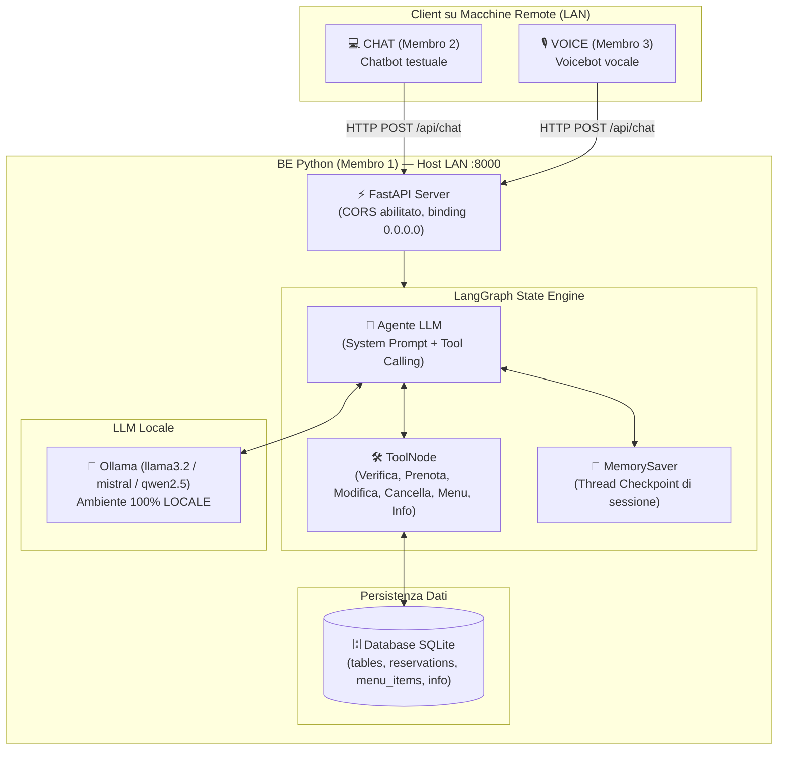

# AI_4_Restaurants — Backend Intelligente (LangGraph & LangChain)

Sistema di intelligenza artificiale per la gestione automatizzata delle prenotazioni e delle informazioni di un noto ristorante (**Trattoria Bella Napoli**), sviluppato in Python con **LangGraph**, **LangChain**, **FastAPI** e **SQLite**.

Questo repository contiene il **Backend (Membro 1)**, progettato per comunicare via rete locale (LAN) con il bot testuale (**CHAT - Membro 2**) e il bot vocale (**VOICE - Membro 3**).

---

## 📐 Architettura del Sistema



---

## 🎯 Casi d'Uso Supportati

1. **Prenotazione di un tavolo**:
   - Assegnazione automatica del tavolo ottimale in base al numero di persone (2, 4, 6, 8, 10 posti) e sala desiderata (*interno, terrazza, giardino*).
   - Controllo turni (*Pranzo 12:00-15:00* e *Cena 19:00-23:30*).
   - Rispetto della chiusura settimanale (*Lunedì chiuso*).
   - Generazione del codice di prenotazione univoco (es. `RES-9A8B2C`).
2. **Modifica di una prenotazione**:
   - Ricerca tramite codice di prenotazione.
   - Modifica di data, orario, numero coperti e note speciali, con ricalcolo e riassegnazione automatica del tavolo.
3. **Cancellazione di una prenotazione**:
   - Cancellazione tramite codice univoco e immediata liberazione del tavolo.
4. **Consultazione del menu**:
   - Ricerca piatti per categoria (*Antipasti, Primi, Secondi, Contorni, Dessert, Bevande*).
   - Filtro per esigenze alimentari e intolleranze (*senza glutine, vegetariano, vegano, allergeni specifici*).
5. **Richiesta informazioni generali**:
   - Indirizzo, orari di apertura, parcheggio convenzionato (*Garage Toledo*), accessibilità disabili, seggioloni bimbi e policy animali domestici.

---

## 🛡️ Rispetto dei Vincoli di Progetto

| Vincolo | Come è stato implementato |
| :--- | :--- |
| **1. Tre componenti su macchine diverse** | Il backend ascolta su `0.0.0.0:8000` con CORS middleware aperto a qualsiasi origine LAN. |
| **2. Comunicazione via rete** | Esposizione di API REST JSON documentate (Swagger / OpenAPI) su protocollo HTTP. |
| **3. Rimozione informazioni personali (PII)** | I client CHAT/VOICE pre-processano i messaggi. Il BE opera esclusivamente con un `customer_id` anonimizzato (es. `anon_user_xyz`) e con il `booking_code` (`RES-XXXXXX`). Il database SQLite non salva nomi completi, email o numeri di telefono privati. |
| **4. Modelli in ambiente LOCALE** | Integrazione diretta con **Ollama** (`ChatOllama`) per modelli eseguiti in locale (es. `llama3.2`, `mistral`, `qwen2.5`). Disponibile anche un `MockChatModel` per test e sviluppo offline senza GPU. |
| **5. Due Stakeholder** | - **Responsabile Tecnico**: Codice modulare, LangGraph StateGraph, type hints Pydantic v2, transazioni SQLAlchemy, suite di test automatizzati (16/16 passati).<br/>- **Ristoratore**: Regole di capienza reali, prevenzione overbooking, gestione turni pranzo/cena, menu campano autentico con allergeni e risposte calorose in italiano. |

---

## 🚀 Guida Rapida all'Installazione

### 1. Prerequisiti
- **Python 3.10+** (testato e verificato con Python 3.14)
- **Ollama** installato in locale ([scarica Ollama](https://ollama.com/download))

### 2. Configurazione Ambiente
```bash
# Clona il repository ed entra nella cartella
cd AI_4_Restaurants

# Crea l'ambiente virtuale
python -m venv venv

# Attiva l'ambiente virtuale
# Su Windows PowerShell:
.\venv\Scripts\Activate.ps1
# Su Linux/macOS:
source venv/bin/activate

# Installa le dipendenze
pip install -r requirements.txt
```

### 3. Configurazione Modello Locale (Ollama)
Scarica ed avvia il modello scelto con Ollama:
```bash
ollama run llama3.2
```
Il file `.env` è già configurato di default:
```env
HOST=0.0.0.0
PORT=8000
LLM_PROVIDER=ollama
OLLAMA_BASE_URL=http://localhost:11434
OLLAMA_MODEL=llama3.2
```

### 4. Avvio del Backend
```bash
python -m backend.main
```
All'avvio, il backend:
- Crea automaticamente il database SQLite (`backend/restaurant.db`).
- Inserisce i tavoli (da 2 a 10 posti), il menu completo e le informazioni sul locale.
- Avvia il server su `http://0.0.0.0:8000`.
- Rende disponibile l'interfaccia interattiva Swagger su `http://localhost:8000/docs`.

---

## 📡 Integrazione per CHAT (Membro 2) e VOICE (Membro 3)

### Endpoint Conversazionale Principale
- **Metodo**: `POST`
- **URL**: `http://<IP_DELLA_MACCHINA_BE>:8000/api/chat`
- **Headers**: `Content-Type: application/json`

#### Payload di Richiesta:
```json
{
  "message": "Vorrei prenotare un tavolo per 4 persone per domani sera alle 20:30",
  "session_id": "sessione_chat_101",
  "customer_id": "anon_user_abc123",
  "client_type": "chat"
}
```
*Note per i client*:
- `client_type` può essere `"chat"` oppure `"voice"`. Quando è impostato su `"voice"`, l'agente adotta uno stile particolarmente fluido ed evita formattazioni complesse per favorire la sintesi vocale TTS.
- `session_id` deve essere mantenuto costante per l'intera durata del dialogo di un utente, consentendo a LangGraph di mantenere lo storico della conversazione.

#### Risposta del Backend:
```json
{
  "reply": "Perfetto! Ho confermato la prenotazione per 4 persone per il 2026-10-15 alle 20:30. Il vostro tavolo è il #4 in sala interna. Il vostro codice di prenotazione è RES-A7B8C9. Ricordate di conservarlo per eventuali modifiche!",
  "session_id": "sessione_chat_101",
  "customer_id": "anon_user_abc123",
  "client_type": "chat",
  "timestamp": "2026-10-14T13:00:00.000Z"
}
```

### Script Client di Test per la Rete LAN
Nella cartella principale è disponibile lo script `client_demo.py` che i membri del team possono eseguire da un'altra macchina della LAN per testare subito l'integrazione:
```bash
python client_demo.py http://<IP_MACCHINA_BE>:8000
```

---

## 🧪 Esecuzione della Suite di Test

Tutti i test unitari e di integrazione (DB, Tools, LangGraph, API REST) possono essere eseguiti con:
```bash
.\venv\Scripts\pytest.exe -v
```
Risultato: **16 passed** (100% coverage delle funzionalità principali).

---

## 👥 Guida alla Presentazione per gli Stakeholder

### 1. Presentazione al Responsabile Tecnico
- **Architettura LangGraph**: Mostra il grafo degli stati in `backend/graph/workflow.py`, spiegando l'uso di `ToolNode`, `tools_condition` e `MemorySaver` per la persistenza del contesto multi-turno su thread ID.
- **Privacy e Conformità Vincoli**: Evidenzia come le PII siano gestite tramite token anonimi (`customer_id`) e come l'LLM operi al 100% in locale tramite Ollama senza trasmettere dati all'esterno.
- **Integrità del Database**: Spiega la logica di `get_available_tables` in `backend/database/crud.py`, che assegna i tavoli con algoritmo best-fit ed evita doppie prenotazioni verificando data, fascia oraria e capienza.
- **Documentazione OpenAPI**: Mostra `http://localhost:8000/docs` con schemi di validazione Pydantic v2 rigorosi.

### 2. Presentazione al Ristoratore
- **Esperienza Utente Naturale**: Dimostra la conversazione in italiano, sia per la prenotazione rapida sia per la modifica o cancellazione tramite codice univoco.
- **Regole di Business**: Mostra come il sistema rispetti la chiusura del Lunedì, i turni di Pranzo e Cena, e risponda con precisione a domande su piatti senza glutine, vegetariani, parcheggio e animali ammessi.
